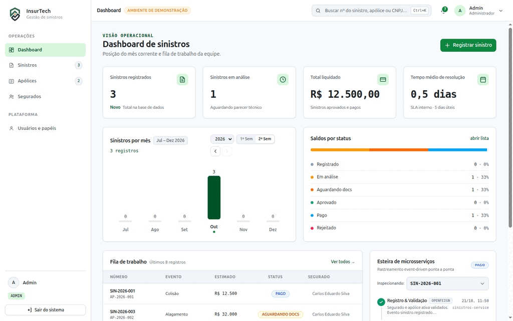
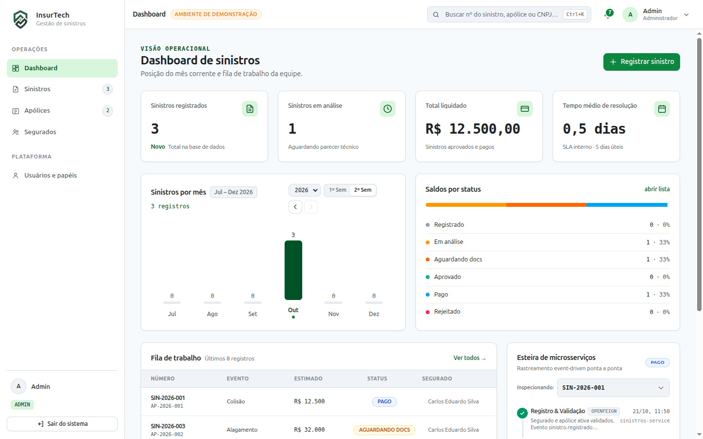
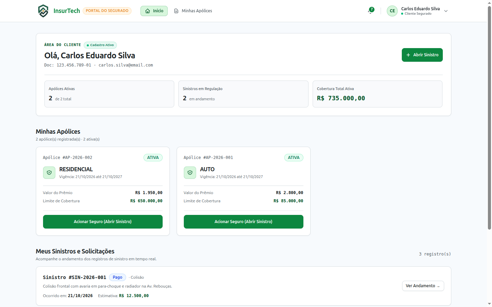
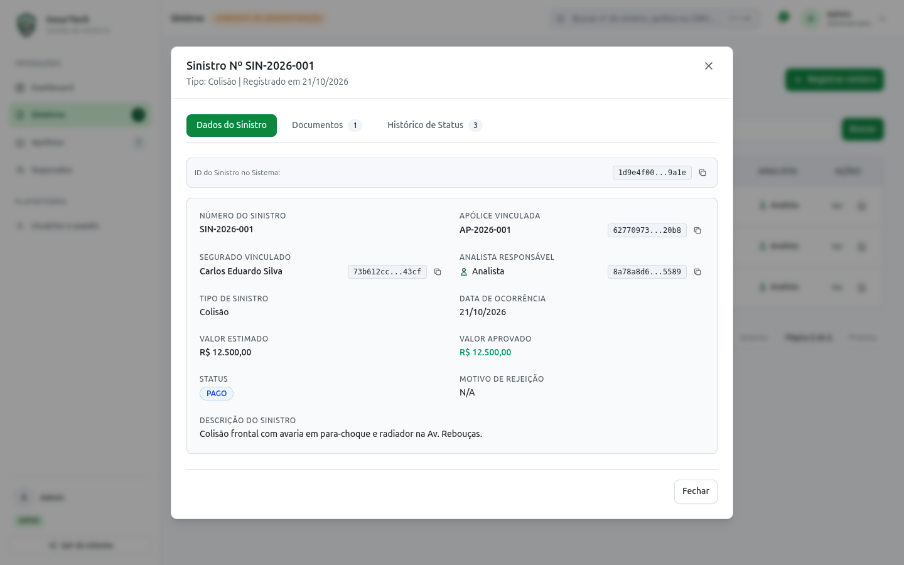
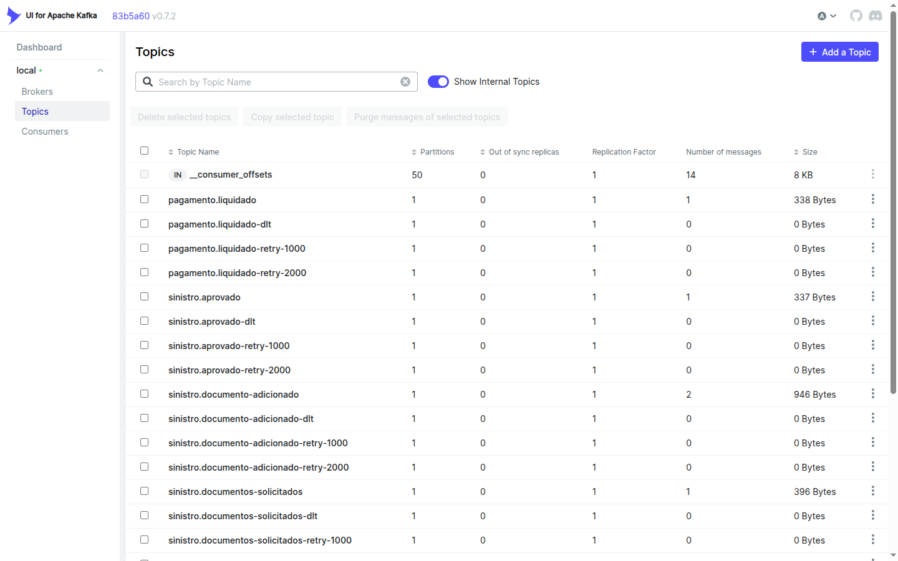

<div align="center">

# InsurTech

### Enterprise Property & Casualty (P&C) Claims and Policy Management Platform

*A hybrid B2B/B2C event-driven microservices platform managing the complete insurance claims lifecycle — from registration to financial settlement.*

<br/>

[Português](./README.md) | **English**

<br/>


</div>

> [!NOTE]
> **Platform Highlights in 5 Lines (TL;DR):**
> 1. **Enterprise Event-Driven Ecosystem**: 7 decoupled microservices built with Java 21 / Spring Boot 3.5 following Clean Architecture, DDD, and a modern React 19 + Tailwind CSS v4 SPA.
> 2. **Bulletproof Transactional Consistency**: *Transactional Outbox* and *Transactional Inbox* patterns backed by Apache Kafka (KRaft), enforcing *Effectively-Once* semantics with zero loss or duplication of settlement events.
> 3. **Hardened Security & Session Isolation**: Enterprise hierarchical RBAC, centralized Anti-IDOR protection, high-entropy CSPRNG password generation, and per-tab session isolation with `sessionStorage` priority.
> 4. **Native Observability & Resilience**: End-to-end distributed tracing via Correlation ID across all tiers without additional APM containers, supported by Resilience4j circuit breakers and distributed Redis rate limiting.
> 5. **Proven Quality & Zero Regressions**: 520 automated tests (334 backend with Testcontainers + 186 frontend with Vitest) running with 100% pass rate and zero failures on CI/CD pipelines.

---

## Visual Platform Showcase

<div align="center">
  
  <p><em>End-to-end lifecycle demonstration: Claim Intake ➔ Regulation & Approval ➔ Settlement via Kafka (Inbox/Outbox) ➔ Real-Time Notification</em></p>
</div>

<br/>

| **B2B Backoffice (Operational Dashboard)** | **B2C Customer Portal (Policyholder Area)** |
|:---:|:---:|
| [](./docs/assets/dashboard-b2b.png) | [](./docs/assets/portal-segurado.png) |
| *Real-time KPI metrics, adjuster work queue & event pipeline* | *Active policies overview, claim intake & live tracking* |

| **Claim Regulation & Document Verification (Drawer)** | **Apache Kafka UI (Real Topics & Event Logs)** |
|:---:|:---:|
| [](./docs/assets/analise-sinistro-drawer.png) | [](./docs/assets/kafka-ui-topics.png) |
| *Auditing timeline, formal document review & approval action* | *Domain topics, non-blocking retry queues & Dead Letter Topics* |

---

## Table of Contents

- [Visual Platform Showcase](#visual-platform-showcase)
- [Overview](#overview)
- [Architecture](#architecture)
- [Tech Stack](#tech-stack)
- [Microservices](#microservices)
- [Business Flow](#business-flow)
- [Frontend](#frontend)
- [Project Structure](#project-structure)
- [Getting Started](#getting-started)
- [Testing](#testing)
- [Access & Credentials](#access--credentials)
- [API Endpoints](#api-endpoints)
- [Technical & Architectural Highlights](#technical--architectural-highlights)
  - [Transactional Outbox Pattern](#1-transactional-outbox-pattern-sinistros-service)
  - [Transactional Inbox Pattern & Strict Idempotency](#2-transactional-inbox-pattern-liquidacao-service--strict-idempotency)
  - [Lightweight Distributed Observability](#3-lightweight-distributed-observability-no-additional-apm-containers)
  - [Bidirectional Document Request & Notification Workflow](#4-bidirectional-document-request--notification-workflow)
  - [B2B User Provisioning & High-Entropy Password Generation](#5-b2b-user-provisioning--high-entropy-password-generation)
  - [Centralized Security Validator Pattern & Anti-IDOR](#6-centralized-security-validator-pattern--anti-idor)
  - [Distributed Cache Hardening with Polymorphic Type Validator](#7-distributed-cache-hardening-with-polymorphic-type-validator)
  - [HTTP Filter Architecture with OncePerRequestFilter & Decoupled OpenAPI Contracts](#8-http-filter-architecture-with-onceperrequestfilter--decoupled-openapi-contracts)
  - [Modern Frontend — React 19 & Native Tailwind CSS v4](#9-modern-frontend--react-19--native-tailwind-css-v4)
  - [Global Test Standardization with @DisplayName and Testcontainers](#10-global-test-standardization-with-displayname-and-testcontainers)
  - [Unified Environment Management with .env & Docker Compose](#11-unified-environment-management-with-env--docker-compose)
  - [Tab-Isolated Session Storage & Reactive Cross-Tab Triggers](#12-tab-isolated-session-storage--reactive-cross-tab-triggers)
  - [Profile-Isolated Notification Read Status & Real-Time Sync](#13-profile-isolated-notification-read-status--real-time-sync)
  - [Robust Form State Validation with Native Accessibility](#14-robust-form-state-validation-with-native-accessibility)
- [License](#license)

---

## Overview

| Dimension | Description |
|---|---|
| **Domain** | Property & Casualty Insurance (P&C) |
| **Type** | Hybrid platform — B2B operational backoffice for analysts/managers + B2C portal for policyholders |
| **Architecture** | Independent microservices with isolated database per service (Database-per-Service: 6 databases) |
| **Communication** | Hybrid: synchronous REST via OpenFeign + asynchronous events via Apache Kafka (KRaft) |
| **Reliability** | **Transactional Outbox** (`sinistros-service`) + **Transactional Inbox** (`liquidacao-service`): end-to-end guarantee *At-Least-Once* ➔ *Effectively-Once* |
| **Internal Pattern** | Clean Architecture + Domain-Driven Design (DDD) in each service |

### System Roles

| Role | Permissions |
|---|---|
| **Admin** | Manages users, assigns roles, unrestricted platform access |
| **Manager (Gestor)** | Access to consolidated dashboard with metrics, general process supervision |
| **Analyst (Analista)** | Registers claims, performs technical review, approves or rejects, requests additional documentation |
| **Policyholder (Segurado)** | Accesses the Policyholder Portal (B2C) — views their exclusive policies and claims, uploads requested documents |

---

## Architecture

The system follows the **API Gateway** pattern as the single entry point for all client applications (B2B Backoffice and B2C Policyholder Portal). Cross-service communication adopts a hybrid, decoupled model: synchronous REST via **OpenFeign with Resilience4j** (circuit breaker and retry) for immediate consistency validations, and **Apache Kafka 3.7 (KRaft)** with the **Transactional Outbox Pattern** and **Transactional Inbox Pattern** for reliable, deduplicated asynchronous business event propagation and consumption.

```
                        ┌────────────────────────────────────────────────────────┐
   React Frontend       │                 gateway-service  :8080                 │
   (SPA via Nginx) ───► │  JWT Auth · CORS · Routing · Rate Limit · Correlation  │
                        └───────────────────────────┬────────────────────────────┘
                                                    │ Redis (Rate Limit)
         ┌──────────────────┬───────────────────────┼───────────────────────┬────────────────────────┐
         │                  │                       │                       │                        │
         ▼                  ▼                       ▼                       ▼                        ▼
┌──────────────────┐┌──────────────────┐┌──────────────────┐ ┌─────────────────────────┐ ┌─────────────────────┐
│   auth-service   ││ segurados-service││ apolices-service │ │    sinistros-service    │ │  notificacao-service│
│      :8084       ││      :8085       ││      :8086       │ │          :8087          │ │        :8089        │
│    [auth_db]     ││  [segurados_db]  ││   [apolices_db]  │ │[sinistros_db|outbox_ev] │ │  [notificacao_db]   │
└────────▲─────────┘└───────▲──▲───────┘└─────────▲────────┘ └──────────┬────────┬───────┘ └──────────▲──────────┘
         │ Feign            │  │                  │                     │        │                    │
         └──────────────────┘  └────── Feign ─────┴─────────────────────┘        │ Kafka (docs, status│
                                                                                 │ notifications)     │
                                                   Kafka: sinistro.aprovado      │                    │
                                                   (Header: immutable X-Event-Id)│                    │
                                                                                 ▼                    │
                                                                     ┌──────────────────────┐         │
                                                                     │   liquidacao-service  │         │
                                                                     │       :8088          │         │
                                                                     │[liquidacao_db|inbox] │         │
                                                                     └──────────┬───────────┘         │
                                                                                │                     │
                                                                    Kafka: pagamento.liquidado        │
                                                                                │                     │
                                                        ┌───────────────────────┴─────────────────────┘
                                                        ▼
                                                 sinistros-service
                                                 (consumer: status → PAGO)

   Shared infrastructure:
   ┌────────────────────────────────┐   ┌─────────────────────┐   ┌─────────────────────┐
   │  PostgreSQL 16                 │   │  Apache Kafka 3.7    │   │     Redis 7         │
   │  (6 isolated databases)        │   │  (KRaft, no ZooK.)  │   │  cache + rate limit │
   │  :5432                         │   │  :9092              │   │  :6379              │
   └────────────────────────────────┘   └─────────────────────┘   └─────────────────────┘
```

### Rate Limiting (Token Bucket via Redis)

The `gateway-service` applies rate limiting globally across all routes with distributed persistence via Redis:

| Parameter | Value |
|---|---|
| **Algorithm** | Token Bucket |
| **Replenish rate** | 10 requests / second |
| **Maximum capacity (burst)** | 20 requests |
| **Resolution key** | Authenticated user ID (`X-Usuario-Id`) → fallback to client IP |
| **Response on exceed** | `429 Too Many Requests` with standardized `X-RateLimit-*` headers |

### Cross-Service Communication

```
sinistros-service
  │
  ├── [Feign GET]            → segurados-service   (validates policyholder when registering claim)
  ├── [Feign GET]            → apolices-service    (validates ACTIVE policy when registering claim)
  │
  ├── [Kafka PRODUCE/Outbox] sinistro.registrado              → notificacao-service
  ├── [Kafka PRODUCE/Outbox] sinistro.aprovado (X-Event-Id)   → liquidacao-service (deduplicated Inbox)
  ├── [Kafka PRODUCE/Outbox] sinistro.rejeitado               → notificacao-service
  ├── [Kafka PRODUCE/Outbox] sinistro.documentos-solicitados  → notificacao-service (alerts policyholder in Portal)
  └── [Kafka PRODUCE/Outbox] sinistro.documento-adicionado    → notificacao-service (alerts analysts in Backoffice)

segurados-service
  └── [Feign POST]           → auth-service        (provisions SEGURADO credentials with CSPRNG)

liquidacao-service (Headless with Transactional Inbox)
  └── [Kafka PRODUCE]        pagamento.liquidado   → sinistros-service · notificacao-service
```

---

## Tech Stack

### Backend

| Technology | Version | Usage |
|---|:---:|---|
| **Java** | `21 LTS` | Primary language — records, virtual threads, sealed classes, pattern matching |
| **Spring Boot** | `3.5.16` | Foundation framework across all 7 microservices |
| **Spring Cloud** | `2025.0.3` | Gateway (reactive WebFlux), OpenFeign, and Resilience4j |
| **Spring Cloud Gateway** | via BOM | Single entry point — routing, JWT auth, rate limiting, and Correlation ID injection |
| **Spring Cloud OpenFeign** | via BOM | Declarative synchronous REST communication across downstream services |
| **Resilience4j** | via BOM | Circuit Breaker and Retry on Feign HTTP calls |
| **Apache Kafka** | `3.7 (KRaft)` | Distributed, high-throughput message broker — without ZooKeeper dependency |
| **Spring Kafka** | via BOM | Typed JSON serialization producers and consumers with header propagation |
| **Spring Data JPA + Hibernate** | via BOM | Relational persistence in `validate` mode — schema 100% managed by Flyway |
| **Flyway** | via BOM | Versioned migrations (`V1__…`, `V2__…`) across all database microservices |
| **Spring Boot Actuator** | via BOM | Granular health checks (Postgres, Redis, Kafka, Disk) and Gateway dynamic routes |
| **MapStruct** | `1.5.5.Final` | Compile-time Domain ↔ DTO ↔ Entity mapper generation |
| **Lombok** | via BOM | Boilerplate elimination (getters, builders, constructors) |
| **Spring Data Redis (Reactive)** | via BOM | Distributed cache with `BasicPolymorphicTypeValidator` (strict anti-RCE whitelist) + Distributed Rate Limiting in Gateway |
| **Spring Security + jjwt** | `0.12.6` | Authentication, JWT issuance, standardized `OncePerRequestFilter` filters, and isolated MDC context |
| **springdoc-openapi** | via BOM | OpenAPI 3 documentation decoupled into contract interfaces (`*ControllerDocs`) |
| **PostgreSQL** | `16` | Relational database — 6 fully isolated databases |
| **Redis** | `7` | In-memory cache and token bucket rate limiter state control |
| **Testcontainers** | via BOM | Real on-demand PostgreSQL 16 and Kafka 3.7 (`ConfluentKafkaContainer`) in integration tests |
| **JUnit 5 + Mockito** | via BOM | Pure unit tests without loading Spring context (`@MockitoBean` / `@MockitoSpyBean`) |

### Frontend

| Technology | Version | Usage |
|---|:---:|---|
| **React** | `19.2.8` | UI library with native `ref` prop, direct Context API without `.Provider`, and Concurrent Features |
| **TypeScript** | `6.0.2` | Strict static typing across the entire codebase |
| **Vite** | `8.2.0` | Ultra-fast build tool and dev server with Hot Module Replacement (HMR) |
| **Tailwind CSS** | `v4.3.3` | Native high-speed compilation via `@tailwindcss/vite` and design tokens in CSS variables |
| **TanStack Query** | `5.101.4` | Client-side async cache, refetching, and state synchronization with the server |
| **React Hook Form** | `7.85.0` | Performant, uncontrolled form management |
| **Zod** | `4.4.3` | Runtime schema-based validation and automatic TypeScript type inference |
| **React Router** | `7.18.2` | Declarative SPA routing with role-based protection (RBAC AuthGuard) |
| **Axios** | `1.19.0` | HTTP client with interceptors for JWT tokens and Correlation ID |
| **Vitest** | `5.0.1` | Native, high-performance Vite test runner |
| **React Testing Library** | `16.3.3` | Component testing focused on user behavior and accessibility |

### Infrastructure

| Technology | Version | Usage |
|---|:---:|---|
| **Docker** | `24+` | Container runtime |
| **Docker Compose** | `v2` | Complete local orchestration of infrastructure and microservices |
| **Nginx** | `Alpine` | HTTP web server and reverse proxy for the SPA with fallback to `index.html` |
| **Kafka UI** | `latest` | Web dashboard for visual inspection of topics, partitions, and consumer offsets |

---

## Microservices

| Service | Port | Type | Responsibility |
|---|:---:|---|---|
| `gateway-service` | **8080** | Routing | Single entry point — JWT validation, rate limiting (Redis), `X-Correlation-Id` injection, and downstream routing |
| `auth-service` | **8084** | Cross-cutting | Authentication, JWT issuance/refresh, hierarchical RBAC, and CSPRNG password generation for policyholders |
| `segurados-service` | **8085** | Domain | Policyholder CRUD (Individual/Corporate) and user provisioning orchestration via Feign on `auth-service` |
| `apolices-service` | **8086** | Domain | Policy management, insurance coverages, and strict validity control |
| `sinistros-service` | **8087** | Core | Complete claim lifecycle, anti-IDOR validation, and Transactional Outbox Pattern |
| `liquidacao-service` | **8088** | Kafka Worker | Consumes `sinistro.aprovado`, deduplicates via **Transactional Inbox** (strict idempotency), settles, and emits `pagamento.liquidado` |
| `notificacao-service` | **8089** | Domain / Events | Consumes lifecycle events, persists in-app notifications (B2B/B2C), and exposes REST API |

> `liquidacao-service` is the only **headless** process in the system — with no business REST endpoints, operating purely as a Kafka consumer protected by a Transactional Inbox. The `notificacao-service` has its own database (`notificacao_db`), versioned Flyway migrations, and a REST API (`/api/v1/notificacoes`) consumed by the Backoffice and Policyholder Portal.

### Databases — Database-per-Service

Each service has its own PostgreSQL database. **There are no foreign keys across databases** — eventual consistency and referential integrity are guaranteed via Kafka events and synchronous validations via OpenFeign.

| Database | Service | Primary Tables |
|---|---|---|
| `auth_db` | auth-service | `usuarios` |
| `segurados_db` | segurados-service | `segurados` |
| `apolices_db` | apolices-service | `apolices`, `coberturas` |
| `sinistros_db` | sinistros-service | `sinistros`, `documentos_sinistro`, `historico_sinistro`, `outbox_events` |
| `liquidacao_db` | liquidacao-service | `eventos_pagamento`, `inbox_events` |
| `notificacao_db` | notificacao-service | `notificacoes` |

---

## Business Flow

### Claims Lifecycle

```
  ┌──────────────┐     ┌─────────────┐     ┌────────────────────────┐
  │  REGISTRADO  │────►│  EM_ANALISE │────►│  AGUARDANDO_DOCUMENTOS │
  └──────────────┘     └──────┬──────┘     └───────────┬────────────┘
                              │                         │
                   ┌──────────┴─────────────────────────┘ (document attached)
                   │
         ┌─────────┴──────────┐
         ▼                    ▼
   ┌──────────┐         ┌───────────┐
   │ APROVADO │         │ REJEITADO │
   └────┬─────┘         └───────────┘
        │
 (Kafka via Outbox: sinistro.aprovado)
        │
        ▼
    ┌──────┐
    │ PAGO │
    └──────┘
```

### Happy Path and Cross-Service Lifecycle

```
 1. Analyst registers claim
    ├── [Feign GET] → segurados-service (validates existing policyholder)
    └── [Feign GET] → apolices-service (validates ACTIVE policy)

 2. Claim persisted with status: REGISTRADO
    └── [Outbox ➔ Kafka] sinistro.registrado → notificacao-service

 3. Analyst takes technical ownership
    └── Status → EM_ANALISE

 4. Analyst requests supplementary documentation (if applicable)
    ├── [PATCH] /api/v1/sinistros/{id}/aguardar-documentos
    ├── Status → AGUARDANDO_DOCUMENTOS
    ├── [Outbox ➔ Kafka] sinistro.documentos-solicitados → notificacao-service
    └── 🔔 Bell notification rings in Policyholder Portal (B2C) with direct upload link

 5. Policyholder uploads requested document in Portal
    ├── [POST] /api/v1/sinistros/{id}/documentos
    ├── Status returns automatically to → EM_ANALISE
    ├── [Outbox ➔ Kafka] sinistro.documento-adicionado → notificacao-service
    └── 🔔 Bell notification rings in Operational Backoffice (B2B) alerting the analyst

 6. Analyst approves the claim
    ├── [PATCH] /api/v1/sinistros/{id}/aprovar
    ├── Status → APROVADO
    └── [Outbox ➔ Kafka] sinistro.aprovado → liquidacao-service

 7. liquidacao-service consumes sinistro.aprovado
    ├── Processes financial payment settlement
    └── [Kafka PRODUCE] pagamento.liquidado

 8. sinistros-service consumes pagamento.liquidado
    └── Status → PAGO

 9. notificacao-service consumes pagamento.liquidado
    └── 🔔 Notification persisted for the policyholder confirming financial settlement
```

### Kafka Topics

| Topic | Producer | Consumers | Description |
|---|---|---|---|
| `sinistro.registrado` | sinistros-service | notificacao-service | Emitted on claim opening; generates registration notification |
| `sinistro.aprovado` | sinistros-service | liquidacao-service | Emitted on approval via Outbox; initiates payment settlement |
| `sinistro.rejeitado` | sinistros-service | notificacao-service | Emitted on technical rejection; notifies policyholder with justification |
| `sinistro.documentos-solicitados` | sinistros-service | notificacao-service | Analyst requests documents; notifies policyholder in B2C Portal |
| `sinistro.documento-adicionado` | sinistros-service | notificacao-service | Policyholder uploads document; notifies analysts in B2B Backoffice |
| `pagamento.liquidado` | liquidacao-service | sinistros-service · notificacao-service | Settlement confirmation; updates claim to PAGO and notifies policyholder |

---

## Frontend

SPA (Single Page Application) served via Nginx, accessed exclusively through the API Gateway at `:8080`. The frontend is divided into two distinct contexts with a consistent design system and strict session governance:

### B2B Backoffice (roles: ADMIN, GESTOR, ANALISTA)

| Screen / Component | Description |
|---|---|
| **Login** | JWT authentication — credentials validated against `auth-service` through the gateway |
| **Notification Bell (Header)** | `NotificationsPopover` displays real-time badge count for unread operational notifications (`lida_interno`) and alerts analysts/managers when policyholders upload documents (`DOCUMENTO_RECEBIDO`), with one-click redirection to the claim |
| **Operational Dashboard** | Aggregated metrics cached in Redis: total claims, approved and pending values, conversion rate, average resolution time, and workload queue per adjuster |
| **Claims (Sinistros)** | Paginated list with advanced filters, registration, approval/rejection, analyst assignment, document requests, and full audit trail |
| **Policies (Apólices)** | Paginated list with policyholder/status filters, creation, editing, and status transitions |
| **Policyholders (Segurados)** | Paginated list with name, CPF, and CNPJ filters; creation and editing (Individual and Corporate). Displays generated policyholder access credentials strictly once |
| **Institutional 404 Page** | `NotFoundPage` renders an institutional, accessible interface for invalid routes, with an intelligent contextual button to return to the Operational Dashboard |

### B2C Policyholder Portal (role: SEGURADO)

| Screen / Component | Description |
|---|---|
| **Portal Login** | Route `/portal/login` — dedicated entry point for policyholders with credential validation |
| **Notification Bell (Header)** | `NotificationsPopover` filtered to the active `seguradoId`, with isolated read state (`lida_segurado`), alerting immediately when additional documents are requested (`DOCUMENTO_SOLICITADO`), with direct link to the upload screen |
| **Policyholder Dashboard** | Personal consolidated view: active policies, ongoing claims, and financial settlement status |
| **My Policies** | Paginated read-only view with details on contracted coverages |
| **My Claims** | Paginated list, detailed timeline tracking, and upload form for supplementary documents |
| **Portal 404 Page** | Invalid URLs under the `/portal/*` scope preserve the B2C context and provide a safe shortcut back to the Policyholder Dashboard |

### In-App Notification Types & Profile-Isolated Read Status

Notifications feature **dual database-level read tracking (`lida_segurado` and `lida_interno`)**. When a policyholder marks a notification as read in the B2C Portal, it remains unread for B2B Backoffice adjusters and vice-versa, ensuring that no critical operational event is lost by the technical regulation team.

| Type | Recipient | Trigger | Icon / Visual |
|---|---|---|---|
| `SINISTRO_REGISTRADO` | Policyholder | New claim registered in the system | Blue (Info) |
| `DOCUMENTO_SOLICITADO` | Policyholder | Analyst puts claim in pending status | Yellow (Warning) |
| `DOCUMENTO_RECEBIDO` | Analyst / Manager | Policyholder attached document via Portal | Blue (Info) |
| `SINISTRO_REJEITADO` | Policyholder | Claim was rejected in technical analysis | Red (Alert) |
| `PAGAMENTO_LIQUIDADO` | Policyholder | Financial settlement successfully processed | Green (Success) |

### Tab-Isolated Session Storage & Reactive Role Validation

To enable operators to seamlessly navigate between the **Backoffice** and the **Policyholder Portal** across concurrent browser tabs without role conflicts or cache collisions:

* **`sessionStorage` Priority Storage**: Each browser tab maintains its own isolated authentication token and role in `sessionStorage`, utilizing `localStorage` strictly as an initial fallback:

| Context | Token Key | Role Key |
|---|---|---|
| **Backoffice** (`ADMIN` / `GESTOR` / `ANALISTA`) | `insurtech_token_internal` | `insurtech_role_internal` |
| **Policyholder Portal** (`SEGURADO`) | `insurtech_token_portal` | `insurtech_role_portal` |

* **Reactive Synchronization Triggers (`storage` and `focus`)**:
  * Upon switching or refocusing a tab (`window.addEventListener('focus')`), `AuthContext` instantly revalidates the integrity of the token and active role to ensure the session remains consistent.
  * The storage event listener (`window.addEventListener('storage')`) proactively detects logouts or credential updates performed in sibling tabs.
* **Safe Disconnection and Cache Invalidation on Role Conflict**:
  * When a role mismatch is detected by the `RotaProtegida` guard or an HTTP request returns `403 Forbidden` from the API Gateway, the affected tab's session is purged (`limparTokens()`), the React Query cache is wiped (`queryClient.clear()`), and the user is immediately redirected to the appropriate login view (`/login` or `/portal/login`), preventing blank screens or residual stale data.

### Claim Status Visual Palette

| Status | Meaning | Action / Next Step |
|---|---|---|
| `REGISTRADO` | Awaiting responsible analyst assignment | Analyst assumes regulation |
| `EM_ANALISE` | Under technical review by adjuster | Request documents, approve, or reject |
| `AGUARDANDO_DOCUMENTOS` | Supplementary documentation pending from customer | Customer uploads in Portal (upload locked in other statuses) |
| `APROVADO` | Technically approved — awaiting financial settlement | Event emitted via Outbox to Kafka |
| `REJEITADO` | Claim closed with documented rejection | Process finished with notification |
| `PAGO` | Financial settlement successfully completed | Payment recorded in audit history |

### Frontend Organization (Feature-Sliced)

```
src/
├── api/                    # HTTP clients (Axios) supporting import.meta.env.VITE_API_URL and 403 interceptor
├── context/                # AuthContext — reactive auth state, storage/focus listeners, and cache purging
├── hooks/                  # useNotificacoes (3s background polling, cross-tab BroadcastChannel)
├── utils/
│   └── tokenStorage.ts     # Context-isolated tokens and roles with sessionStorage priority
├── features/
│   ├── sinistros/          # hooks · components (timeline, modal, conditional upload) · schemas · types
│   ├── apolices/           # hooks · components · schemas · types
│   ├── segurados/          # hooks · components · schemas · types
│   ├── dashboard/          # hooks · components (metrics, microservice timeline, KPIs)
│   └── portal-segurado/    # B2C Portal — policyholder-exclusive pages, layout, timeline, and uploads
├── pages/                  # Composition of features (Dashboard, Claims, Policies, Customers, NotFoundPage)
├── components/             # Shared UI primitives (layout, HeaderSearch, NotificationsPopover, modals)
└── routes/                 # Route configuration (AppRouter) + RotaProtegida (reactive RBAC guard)
```

---

## Project Structure

```
insurtech/
├── backend/
│   ├── auth-service/            # Authentication, user management, hierarchical RBAC, and CSPRNG generator
│   ├── segurados-service/       # Policyholder CRUD (PF/PJ) and user provisioning orchestration via Feign
│   ├── apolices-service/        # Policies, insurance coverages, and validity
│   ├── sinistros-service/       # Core: claim lifecycle, anti-IDOR, and Transactional Outbox
│   ├── liquidacao-service/      # Headless Kafka worker: financial settlement processing
│   ├── notificacao-service/     # Kafka event consumption, persistence (PostgreSQL), and REST API
│   └── gateway-service/         # Reactive API Gateway (WebFlux, Redis Rate Limiting, Correlation ID)
│
├── frontend/                    # React 19 + Vite 8 + TypeScript 6 + Tailwind v4
│   ├── src/                     # Source code (feature-sliced architecture)
│   ├── .env.example             # Gateway API URL configuration template (VITE_API_URL)
│   ├── Dockerfile               # Multi-stage build: Node 22 (build) + Nginx Alpine (serve)
│   └── nginx.conf               # SPA fallback — redirection of all routes to index.html
│
├── .env.example                 # Environment variables template for infra, ports, and secrets
├── docker-compose.yml           # Complete local orchestration parameterized with environment variables
├── init-databases.sql           # Database creation for the 6 PostgreSQL databases (auth, segurados, apolices, sinistros, liquidacao, notificacao)
├── OUTBOX_PATTERN.md            # Consolidated technical guide: Transactional Outbox Pattern
├── INBOX_PATTERN.md             # Consolidated technical guide: Transactional Inbox Pattern & Kafka Idempotency
├── OBSERVABILIDADE.md           # Consolidated technical guide: Lightweight Distributed Observability
├── NOTIFICACAO_DOCUMENTOS.md    # Consolidated technical guide: Bidirectional Notification Workflow
├── README.md                    # Official project documentation (Portuguese)
└── README.en.md                 # Official project documentation (English)
```

### Internal Clean Architecture (Per Microservice)

```
<service>/src/main/java/com/insurtech/<domain>/
│
├── domain/                      # Pure core — zero external framework dependencies
│   ├── model/                   # Entities and Value Objects
│   ├── event/                   # Domain Events (e.g., SinistroAprovadoEvent, DocumentosSolicitadosEvent)
│   ├── exception/               # Business exceptions (Portuguese naming convention)
│   └── repository/              # Repository interfaces (output ports)
│
├── application/                 # Use cases — orchestrates domain and ports
│   ├── usecase/                 # One file per usecase (SRP)
│   ├── dto/                     # Request / Response DTOs
│   ├── port/                    # Input ports (usecase interfaces) and Output ports (EventPublisherPort)
│   └── validator/               # Centralized security validators (e.g., SinistroSecurityValidator)
│
├── infrastructure/              # Output adapters (technical implementations)
│   ├── persistence/             # JPA entities · Flyway migrations · repositories · outbox/inbox entities
│   ├── messaging/               # Kafka producers, consumers, and OutboxEventRelay (@Scheduled)
│   ├── client/                  # OpenFeign clients with Resilience4j for cross-service calls
│   ├── mapper/                  # MapStruct 1.5.5 (Domain ↔ DTO ↔ JPA Entity)
│   ├── security/                # UserContextFilter (OncePerRequestFilter + SLF4J MDC) · UserContextHolder
│   ├── cache/                   # Redis — cache with BasicPolymorphicTypeValidator anti-RCE
│   └── config/                  # Technical configs (Kafka, Redis, OpenAPI, Feign, Actuator)
│
└── interfaces/                  # Input adapters (HTTP)
    ├── controller/              # REST Controllers decoupled via *ControllerDocs (OpenAPI 3)
    └── exception/               # Standardized GlobalExceptionHandler per service
```

---

## Getting Started

### Prerequisites

| Tool | Minimum Version | Usage |
|---|:---:|---|
| **Docker** | `24+` | Container runtime |
| **Docker Compose** | `v2+` | Local orchestration |
| **Java** | `21` | Manual build and execution of backend services |
| **Node.js** | `22` | Development and execution of frontend |

---

### Option 1 — Docker Compose *(Recommended)*

Launch the complete infrastructure, microservices, and frontend with a single command:

```bash
# Clone the repository
git clone https://github.com/kau4dev/insurtech.git
cd insurtech

# Configure environment variables from example templates
cp .env.example .env
cp frontend/.env.example frontend/.env

# Build and start all infrastructure + microservices + frontend
docker compose up --build
```

After initialization, access platform resources:

| Resource | URL | Description |
|---|---|---|
| **Frontend (Backoffice & Portal)** | http://localhost:5173 | React 19 SPA application |
| **API Gateway** | http://localhost:8080 | Single API entry point |
| **Actuator — Gateway Health** | http://localhost:8080/actuator/health | Detailed health check (Redis, disk, overall status) |
| **Actuator — Gateway Routes** | http://localhost:8080/actuator/gateway/routes | Dynamic tracking of routes and filters |
| **Kafka UI** | http://localhost:8081 | Visual monitoring of topics and partitions |
| **Swagger — sinistros** | http://localhost:8087/swagger-ui.html | REST documentation for sinistros-service |
| **Swagger — segurados** | http://localhost:8085/swagger-ui.html | REST documentation for segurados-service |
| **Swagger — apólices** | http://localhost:8086/swagger-ui.html | REST documentation for apolices-service |
| **Swagger — auth** | http://localhost:8084/swagger-ui.html | REST documentation for auth-service |
| **Swagger — notificações** | http://localhost:8089/swagger-ui.html | REST documentation for notificacao-service |

---

### Option 2 — Local Development *(Infra via Docker, Manual Services)*

Ideal for active development with hot reload on each service:

```bash
# 1. Configure local environment variables
cp .env.example .env
cp frontend/.env.example frontend/.env

# 2. Start core shared infrastructure only
docker compose up -d postgres kafka redis kafka-ui

# 3. Launch each backend service (in separate terminals or tabs)
cd backend/auth-service        && ./mvnw spring-boot:run
cd backend/segurados-service   && ./mvnw spring-boot:run
cd backend/apolices-service    && ./mvnw spring-boot:run
cd backend/sinistros-service   && ./mvnw spring-boot:run
cd backend/liquidacao-service  && ./mvnw spring-boot:run
cd backend/notificacao-service && ./mvnw spring-boot:run
cd backend/gateway-service     && ./mvnw spring-boot:run

# 4. Start frontend with HMR
cd frontend && npm install && npm run dev
```

> **Tip:** The `gateway-service` requires a Redis connection for the Token Bucket rate limiter. Ensure Redis is running via `docker compose up -d redis`.

---

## Testing

### Backend (Per Service)

Each microservice is tested **completely independently**, with no cross-compilation or root POM dependency:

```bash
cd backend/<service-name>

# Unit tests — ultra-fast, no Docker, no Spring context
./mvnw test -Dtest='*Test'

# Integration tests — requires Docker running (Testcontainers)
./mvnw test -Dtest='*IT'

# Complete test suite for the microservice
./mvnw test -Dtest='*Test,*IT'
```

> **Testcontainers:** Integration tests (`*IT`) for database-backed services automatically spin up ephemeral PostgreSQL 16 and Kafka 3.7 instances. The `notificacao-service` uses H2 in-memory with `@EmbeddedKafka` for record execution speeds in CI pipelines.

### Frontend

```bash
cd frontend

# Run all unit tests (Vitest 5)
npm test

# Interactive watch mode
npm run test:watch

# Type check and production build
npm run build
```

### Current Test Coverage

| Module | Suite / Technologies | Tests | Status |
|---|---|:---:|:---:|
| `auth-service` | Unit & Integration (Spring Boot 3.5 + Testcontainers PostgreSQL) | 50 | ✅ |
| `segurados-service` | Unit & Integration (Spring Boot 3.5 + Testcontainers PostgreSQL) | 58 | ✅ |
| `apolices-service` | Unit & Integration (Spring Boot 3.5 + Testcontainers PostgreSQL) | 47 | ✅ |
| `sinistros-service` | Unit (59) + Integration Testcontainers Postgres & Kafka (28) + Validations | 130 | ✅ |
| `liquidacao-service` | Unit & Inbox Pattern Idempotency (JUnit 5 + Mockito) | 7 | ✅ |
| `notificacao-service` | Unit & Integration (H2 in-memory + EmbeddedKafka) | 18 | ✅ |
| `gateway-service` | Unit (JUnit 5 + Reactor) + Integration (WebTestClient) | 24 | ✅ |
| **Total Backend** | **JUnit 5 + Mockito + Testcontainers (7 microservices)** | **334** | **✅** |
| **Frontend** | **Unit, Hooks, Pages & Components (Vitest 5 + React Testing Library)** | **186** | **✅** |
| **Total Ecosystem** | **Complete Automated Test Suite (Zero failures / 100% passing)** | **520** | **✅** |

---

## Access & Credentials

### PostgreSQL

| Parameter | Value |
|---|---|
| **Host** | `localhost:5432` |
| **User** | `insurtech` |
| **Password** | `insurtech` |
| **Databases** | `auth_db` · `segurados_db` · `apolices_db` · `sinistros_db` · `liquidacao_db` · `notificacao_db` |

### Default Seeded Users *(initial seed in `auth_db`)*

#### Backoffice (B2B)

| Email | Password | Role | Access |
|---|---|:---:|---|
| `admin@insurtech.com` | `password` | `ADMIN` | Unrestricted — complete platform administration |
| `gestor@insurtech.com` | `password` | `GESTOR` | Operational dashboard + oversight |
| `analista@insurtech.com` | `password` | `ANALISTA` | Claim adjustment and operations |

#### Policyholder Portal (B2C)

Users with the `SEGURADO` role are automatically provisioned during policyholder creation (or via the administrative endpoint `POST /api/v1/auth/usuarios`). Passwords are generated using a CSPRNG algorithm (`java.security.SecureRandom`) and displayed **strictly once** in the creation modal.

> The credentials above are intended exclusively for local development and test environments. Never use default passwords in production.

---

## API Endpoints

All endpoints are routed through the **API Gateway** at `http://localhost:8080`. The gateway validates the JWT token, injects the `X-Usuario-Id`, `X-Usuario-Papel`, and `X-Correlation-Id` headers, and forwards the request to downstream microservices.

### Auth (`auth-service`)

| Method | Route | Description | Auth |
|---|---|---|:---:|
| `POST` | `/api/v1/auth/login` | Authentication — validates credentials and issues JWT | — |
| `POST` | `/api/v1/auth/usuarios` | Registers user with hierarchical RBAC (ADMIN/GESTOR only) | JWT |
| `GET` | `/api/v1/auth/usuarios/{id}` | Fetches user profile by ID | JWT |
| `GET` | `/api/v1/auth/usuarios` | Lists users — optional filter by `ativo` status | JWT |
| `PATCH` | `/api/v1/auth/usuarios/{id}` | Reactivates an inactive user | JWT |
| `DELETE` | `/api/v1/auth/usuarios/{id}` | Logical deactivation of user | JWT |

### Policyholders (`segurados-service`)

| Method | Route | Description | Auth |
|---|---|---|:---:|
| `POST` | `/api/v1/segurados` | Registers policyholder (Individual/Corporate) + provisions SEGURADO user via Feign | JWT |
| `GET` | `/api/v1/segurados` | Paginated list — filters: `nome`, `cpf`, `cnpj` | JWT |
| `GET` | `/api/v1/segurados/{id}` | Complete policyholder details | JWT |
| `PUT` | `/api/v1/segurados/{id}` | Updates policyholder registration data | JWT |

### Policies (`apolices-service`)

| Method | Route | Description | Auth |
|---|---|---|:---:|
| `POST` | `/api/v1/apolices` | Creates policy linked to a valid policyholder | JWT |
| `GET` | `/api/v1/apolices` | Paginated list — filters: `status`, `tipo`, `seguradoId` | JWT |
| `GET` | `/api/v1/apolices/{id}` | Policy details with coverages | JWT |
| `PATCH` | `/api/v1/apolices/{id}/status` | Updates policy status (ATIVA, CANCELADA, SUSPENSA) | JWT |

### Claims (`sinistros-service`)

| Method | Route | Description | Auth |
|---|---|---|:---:|
| `POST` | `/api/v1/sinistros` | Registers claim (validates active policy and customer via Feign) | JWT |
| `GET` | `/api/v1/sinistros` | Paginated list with advanced filters (status, type, dates, analyst) | JWT |
| `GET` | `/api/v1/sinistros/{id}` | Complete claim details and attached documents | JWT |
| `PATCH` | `/api/v1/sinistros/{id}/atribuir` | Assigns responsible analyst to claim | JWT |
| `PATCH` | `/api/v1/sinistros/{id}/aguardar-documentos` | Places claim on pending documents and emits Kafka event via Outbox | JWT |
| `PATCH` | `/api/v1/sinistros/{id}/aprovar` | Approves claim and triggers settlement via Outbox | JWT |
| `PATCH` | `/api/v1/sinistros/{id}/rejeitar` | Rejects claim with substantiated justification | JWT |
| `POST` | `/api/v1/sinistros/{id}/documentos` | Attaches document to claim (returns status to EM_ANALISE) | JWT |
| `GET` | `/api/v1/sinistros/{id}/historico` | Complete audit history and status changes | JWT |
| `GET` | `/api/v1/sinistros/dashboard/resumo` | Consolidated operational metrics cached in Redis | JWT |

### Notifications (`notificacao-service`)

| Method | Route | Description | Auth |
|---|---|---|:---:|
| `GET` | `/api/v1/notificacoes` | Lists notifications — optional filters: `seguradoId`, `apenasNaoLidas` | JWT |
| `PATCH` | `/api/v1/notificacoes/{id}/lida` | Marks a specific notification as read | JWT |
| `PATCH` | `/api/v1/notificacoes/marcar-todas-lidas` | Marks all notifications as read (globally or by `seguradoId`) | JWT |

### Observability & Actuator

| Method | Route | Description | Auth |
|---|---|---|:---:|
| `GET` | `/actuator/health` | Detailed health check (PostgreSQL, Redis, Kafka, Disk) across all 7 services | — / JWT |
| `GET` | `/actuator/gateway/routes` | Dynamic inspection of Gateway routes and filters | — / JWT |
| `GET` | `/actuator/info` | Application version and metadata information | — / JWT |

---

## Technical & Architectural Highlights

### 1. Transactional Outbox Pattern (`sinistros-service`)

The greatest challenge in distributed event-driven systems is the **Dual-Write Inconsistency** problem: saving state into a relational database and publishing messages to Kafka is not a natively atomic operation. If the database write succeeds but Kafka fails, the event is permanently lost; if the event is published first but the database transaction rolls back, phantom events circulate across downstream services.

```
[HTTP Request]
        │
        ▼
┌──────────────────────────────────────────────────────────────┐
│  sinistros-service (Atomic ACID Transaction in PostgreSQL)   │
│  BEGIN TRANSACTION;                                          │
│    1. UPDATE sinistros SET status = 'APROVADO';              │
│    2. INSERT INTO outbox_events (topic, payload, 'PENDENTE');│
│  COMMIT;                                                     │
└──────────────────────────────┬───────────────────────────────┘
                               │
            ┌──────────────────┴──────────────────┐
            │ Asynchronous Poller (@Scheduled)    │
            ▼                                     ▼
   [Reads PENDENTE events]               [Kafka unavailable?]
            │                                     │
            ▼                                     ▼
   [Publishes to Kafka with X-Event-Id]  [Keeps on disk and retries next cycle]
            │
            ▼
   [UPDATE outbox_events SET status = 'PROCESSADO']
```

* **Unified ACID Transaction**: The business entity state and the event record in `outbox_events` are persisted within the exact same physical PostgreSQL transaction.
* **`outbox_events` Table**: Designed with a composite index `(status, created_at ASC)` for high-performance poller queries:
  ```sql
  CREATE TABLE outbox_events (
      id UUID PRIMARY KEY,
      aggregate_type VARCHAR(50) NOT NULL,
      aggregate_id VARCHAR(100) NOT NULL,
      topic VARCHAR(100) NOT NULL,
      payload TEXT NOT NULL,
      correlation_id VARCHAR(100),
      status VARCHAR(20) NOT NULL DEFAULT 'PENDENTE',
      tentativas INT NOT NULL DEFAULT 0,
      erro TEXT,
      created_at TIMESTAMP WITH TIME ZONE NOT NULL,
      processed_at TIMESTAMP WITH TIME ZONE
  );
  ```
* **Asynchronous Relay (`OutboxEventRelay`)**: A `@Scheduled(fixedDelay = 2000)` worker that reads pending events in batches (`BATCH_SIZE = 50`), dispatches them via `KafkaTemplate.send(record)`, and marks them as `PROCESSADO` reactively (`whenComplete`).
* **Immutable `X-Event-Id` Propagation**: The relay injects the immutable Outbox event UUID into the Kafka record header `X-Event-Id`, enabling strict consumer deduplication (Inbox Pattern).
* **Guaranteed At-Least-Once Delivery**: On network timeouts or partition rebalances, the event remains `PENDENTE`, increments `tentativas`, and is retried next cycle, transitioning to `FALHA` after 5 consecutive failures.
* **Fault Tolerance and Extreme Resilience**: When Kafka is completely down (Kafka DOWN), the HTTP API responds `200 OK` immediately to the client, as the event is 100% safeguarded on PostgreSQL disk. When the broker recovers, the relay drains all pending events with zero data loss.
* **JPA Entity with Explicit Setters**: Replaces builders on JPA entities with explicit setters, guaranteeing a clean lifecycle and strict Hibernate compatibility.
* 📖 *Consolidated step-by-step guide:* [`OUTBOX_PATTERN.md`](./OUTBOX_PATTERN.md)

---

### 2. Transactional Inbox Pattern (`liquidacao-service` — Strict Idempotency)

Apache Kafka provides **At-Least-Once** delivery semantics by default. Messages can be redelivered during Outbox Relay retries, partition rebalances, or delayed commit acknowledgements.

In critical financial operations — such as insurance claim settlement — processing a duplicate event would cause repeated payouts worth tens of thousands of dollars. Naive solutions based on `topic-partition-offset` fail because message retries receive brand-new offsets on the broker.

The **Transactional Inbox Pattern** solves this end-to-end:

```
  ┌──────────────────────────────────────────────────────────────┐
  │  sinistros-service (Outbox Producer)                         │
  │  OutboxEventRelay dispatches ProducerRecord with:            │
  │    - Header: X-Correlation-Id: <uuid>                       │
  │    - Header: X-Event-Id: <outbox_event_id> (Immutable UUID)  │
  └──────────────────────────────┬───────────────────────────────┘
                                 │
                                 │ Kafka: sinistro.aprovado
                                 ▼
  ┌──────────────────────────────────────────────────────────────┐
  │  liquidacao-service (Inbox Consumer)                         │
  │                                                              │
  │  @KafkaListener extracts X-Event-Id                          │
  │  BEGIN TRANSACTION (liquidacao_db);                          │
  │                                                              │
  │    1. SELECT EXISTS FROM inbox_events                        │
  │       WHERE message_id = :eventId;                           │
  │                                                              │
  │    ┌─────────────────────────┴─────────────────────────┐     │
  │    ▼ [IF ALREADY PROCESSED]                            ▼     │
  │  log.warn("Duplicate event skipped!");            [BRAND-NEW]│
  │  COMMIT (Discards without paying again)                │     │
  │                                                        │     │
  │    2. INSERT INTO inbox_events (message_id, ...);      │     │
  │    3. INSERT INTO eventos_pagamento (sinistro_id, ...);│     │
  │  COMMIT;                                               ▼     │
  │                                                              │
  │    4. Publishes pagamento.liquidado to Kafka                 │
  └──────────────────────────────────────────────────────────────┘
```

* **Message Primary Key (`message_id`)**: The `inbox_events` table stores the `message_id` as its `PRIMARY KEY`:
  ```sql
  CREATE TABLE inbox_events (
      message_id VARCHAR(100) PRIMARY KEY,
      consumer_name VARCHAR(100) NOT NULL,
      topic VARCHAR(100) NOT NULL,
      payload TEXT,
      correlation_id VARCHAR(100),
      status VARCHAR(20) NOT NULL,
      created_at TIMESTAMP WITH TIME ZONE NOT NULL,
      processed_at TIMESTAMP WITH TIME ZONE
  );
  ```
* **Atomic ACID Transaction**: Inserting into the inbox table and creating the financial payout record in `eventos_pagamento` execute within the exact same physical PostgreSQL transaction.
* **Safe Duplicate Skipping**: If `message_id` already exists with status `PROCESSADO`, the event is discarded with an explanatory log without triggering a new payout and without failing the listener (preventing infinite DLT retry loops).
* **Guaranteed Effectively-Once Processing**: Combining *Transactional Outbox* on the producer with *Transactional Inbox* on the consumer guarantees that business operations execute exactly once.
* 📖 *Consolidated step-by-step guide:* [`INBOX_PATTERN.md`](./INBOX_PATTERN.md)

---

### 3. Lightweight Distributed Observability (No Additional APM Containers)

The platform adopts an enterprise distributed tracing and observability architecture with high efficiency, **requiring no additional APM containers (no Prometheus, no Grafana, no Jaeger)** and maintaining **minimal JVM memory overhead**, operating natively via Correlation ID in SLF4J/MDC and unified structured logging.

```
[HTTP Request]
        │
        ▼
┌────────────────────────────────────────────────────────┐
│  gateway-service (:8080)                               │
│  - CorrelationIdFilter (Generates X-Correlation-Id)    │
│  - Injects into downstream request                     │
│  - Returns in HTTP response header                     │
└──────────────────────────┬─────────────────────────────┘
                           │  HTTP with X-Correlation-Id
                           ▼
┌────────────────────────────────────────────────────────┐
│  sinistros-service (and other HTTP services)           │
│  - UserContextFilter reads X-Correlation-Id ➔ MDC      │
│  - FeignConfig propagates X-Correlation-Id via REST    │
│  - Log outputs [sinistros-service, <correlationId>]    │
└──────────────────────────┬─────────────────────────────┘
                           │  Kafka Header: X-Correlation-Id
                           ▼
┌────────────────────────────────────────────────────────┐
│  liquidacao-service / notificacao-service              │
│  - Kafka Consumer reads X-Correlation-Id from headers  │
│  - Log outputs [liquidacao-service, <correlationId>]   │
└────────────────────────────────────────────────────────┘
```

* **End-to-End Correlation ID**: The `gateway-service` (`CorrelationIdFilter`, order `-2`) generates a unique UUID in `X-Correlation-Id` or preserves an existing header if supplied by the client.
* **SLF4J MDC in HTTP Filters**: In every microservice, `UserContextFilter` extracts `X-Correlation-Id`, populates `MDC.put("correlationId", ...)`, and guarantees cleanup in a `finally` block to prevent thread pool contamination.
* **Synchronous Propagation via OpenFeign**: The interceptor in `FeignConfig` forwards `X-Correlation-Id`, `X-Usuario-Id`, and `X-Usuario-Papel` automatically across all inter-service REST calls.
* **Asynchronous Propagation via Kafka Headers**: `KafkaSinistroEventPublisher` and `OutboxEventRelay` record the Correlation ID into Kafka headers (`RecordHeaders`). Consumers (`liquidacao-service`, `notificacao-service`, `sinistros-service`) extract the value and hydrate the consumer thread's MDC.
* **Standardized, Colorized Logs**:
  ```properties
  logging.pattern.console=%clr(%d{yyyy-MM-dd HH:mm:ss.SSS}){faint} %clr(${LOG_LEVEL_PATTERN:-%5p}) %clr([${spring.application.name:-},%X{correlationId:-},%X{usuarioId:-}]){magenta} %clr(---){faint} %clr([%15.15t]){faint} %clr(%-40.40logger{39}){cyan} %clr(:){faint} %m%n${LOG_EXCEPTION_CONVERSION_WORD:-%wEx}
  ```
  Allows tracing the complete lifecycle of a request across all microservices with a single terminal command:
  ```bash
  docker compose logs | grep "e4a7f01c-6b3a-4e89-a567-c1d9f8e43210"
  ```
* **Granular Spring Boot Actuator**: Standardized exposure of detailed `/actuator/health` across all 7 services (monitoring PostgreSQL, Redis, Kafka, and Disk) and `/actuator/gateway/routes` on the Gateway.
* 📖 *Consolidated step-by-step guide:* [`OBSERVABILIDADE.md`](./OBSERVABILIDADE.md)

---

### 4. Bidirectional Document Request & Notification Workflow

The platform implements a complete, reactive communication lifecycle between the **Operational Backoffice (B2B)** and the **Policyholder Portal (B2C)**:

```
 ┌────────────────────────────────────────────────────────────────────────┐
 │ FLOW 1: Analyst requests document ➔ Policyholder is notified           │
 └────────────────────────────────────────────────────────────────────────┘
 [Analyst in Backoffice]
          │
          ▼ PATCH /api/v1/sinistros/{id}/aguardar-documentos
 ┌────────────────────────────────────────────────────────┐
 │ sinistros-service                                      │
 │ - Status ➔ AGUARDANDO_DOCUMENTOS                      │
 │ - Kafka PRODUCE via Outbox: documentos-solicitados     │
 └──────────────────────────┬─────────────────────────────┘
                            │
                            ▼
 ┌────────────────────────────────────────────────────────┐
 │ notificacao-service                                    │
 │ - Persists Notification (DOCUMENTO_SOLICITADO)         │
 └──────────────────────────┬─────────────────────────────┘
                            │
                            ▼
 [Policyholder Portal (B2C)]
 🔔 Bell notification rings! Pending documents badge and direct upload link.


 ┌────────────────────────────────────────────────────────────────────────┐
 │ FLOW 2: Policyholder uploads document ➔ Analyst/Manager is notified    │
 └────────────────────────────────────────────────────────────────────────┘
 [Policyholder in Portal]
          │
          ▼ POST /api/v1/sinistros/{id}/documentos
 ┌────────────────────────────────────────────────────────┐
 │ sinistros-service                                      │
 │ - Status automatically returns to ➔ EM_ANALISE        │
 │ - Kafka PRODUCE via Outbox: documento-adicionado       │
 └──────────────────────────┬─────────────────────────────┘
                            │
                            ▼
 ┌────────────────────────────────────────────────────────┐
 │ notificacao-service                                    │
 │ - Persists Notification (DOCUMENTO_RECEBIDO)           │
 └──────────────────────────┬─────────────────────────────┘
                            │
                            ▼
 [Operational Backoffice (B2B)]
 🔔 Bell notification rings in Backoffice Header! Analyst clicks and reviews.
```

* **B2B ➔ B2C Flow**: The adjuster marks the claim as pending documents (`PATCH /api/v1/sinistros/{id}/aguardar-documentos`). The `sinistro.documentos-solicitados` event is published via Outbox. The `notificacao-service` persists the record, and the Policyholder Portal's bell illuminates with an unread badge and direct link to the upload form.
* **B2C ➔ B2B Flow**: The customer uploads the file (`POST /api/v1/sinistros/{id}/documentos`). The claim status automatically reverts to `EM_ANALISE`. The `sinistro.documento-adicionado` event is published via Outbox. The `notificacao-service` stores the notification, alerting the backoffice team to resume technical review.
* **Reactive Popovers (`NotificationsPopover`)**: Header interface component with live counter badges, role filtering, individual/bulk read marking, and one-click navigation.
* 📖 *Consolidated step-by-step guide:* [`NOTIFICACAO_DOCUMENTOS.md`](./NOTIFICACAO_DOCUMENTOS.md)

---

### 5. B2B User Provisioning & High-Entropy Password Generation

Access security and identity creation follow strict corporate compliance standards:

* **Strict Hierarchical RBAC (`POST /api/v1/auth/usuarios`)**:
  * `ADMIN` is the ecosystem root account, seeded exclusively through the initial migration (`V1__create_usuarios.sql`). Creating new administrators via the API is strictly prohibited.
  * `ADMIN` and `GESTOR` operators have permission to provision new users under the `GESTOR`, `ANALISTA`, and `SEGURADO` roles.
  * Users with `ANALISTA` and `SEGURADO` roles are barred from provisioning any accounts.
* **CSPRNG Password Generation (`GeradorSenhaService`)**:
  * For the `SEGURADO` role, any password supplied in the request body is ignored. The system generates high-entropy credentials using `java.security.SecureRandom` (CSPRNG — Cryptographically Secure Pseudo-Random Number Generator), enforcing at least one uppercase letter, one lowercase letter, one digit, and one special symbol across 12+ characters.
  * Characters are shuffled using the **Fisher-Yates Shuffle** algorithm. `java.util.Random` is never used.
* **Single Exposure and Secure Hashing**:
  * The generated plaintext password is returned **strictly once** in the creation response payload (`UsuarioCriadoResponseDTO`) so the operator can transmit it to the customer.
  * The password is never stored in plaintext nor logged. In `auth_db`, the hash is persisted using BCrypt (strength 12).
* **Automatic Orchestration during Policyholder Registration**:
  * When creating a policyholder in `segurados-service`, if `usuarioId` is omitted, the service calls `AuthClient` via OpenFeign, provisions the user in `auth-service`, and transparently links the returned UUID.

---

### 6. Centralized Security Validator Pattern & Anti-IDOR

To avoid fragmented, duplicated security logic and guarantee complete protection against Insecure Direct Object References (IDOR):

* **Dedicated Security Component (`SinistroSecurityValidator`)**:
  UseCases never perform raw context parsing or manual role checks directly. The validator centralizes:
  * `validarAutenticacao()`: Guarantees `X-Usuario-Id` presence and non-blank values.
  * `validarPapeis(String... papeisPermitidos)`: Asserts that the acting user role (`X-Usuario-Papel`) belongs to the allowed list.
  * `validarPropriedadeSegurado(seguradoId, mensagem)`: Guarantees that requests from the Policyholder Portal (`SEGURADO`) only query resources belonging to their own verified `seguradoId`.
  * `buscarEValidarPropriedadeSegurado(seguradoId, mensagem)`: Fetches the customer via Feign and verifies ownership against `X-Usuario-Id`.
* **Frontend Session Isolation**:
  JWT tokens managed with priority in per-tab `sessionStorage` and dedicated keys (`insurtech_token_internal` for B2B and `insurtech_token_portal` for B2C), with persistence fallback in `localStorage` to avoid accidental sign-outs and prevent cross-contamination when the same operator uses the Backoffice and Portal in simultaneous tabs.
* **Database-per-Service with 6 Isolated Databases**:
  `auth_db`, `segurados_db`, `apolices_db`, `sinistros_db`, `liquidacao_db`, `notificacao_db`. Zero coupling via physical foreign keys across microservices.

---

### 7. Distributed Cache Hardening with Polymorphic Type Validator

To mitigate critical **Remote Code Execution (RCE)** vulnerabilities associated with unrestricted polymorphic deserialization in distributed Redis caches, `sinistros-service` replaces deprecated methods with a strict type validator:

* **Strict Package Whitelist**:
  ```java
  PolymorphicTypeValidator ptv = BasicPolymorphicTypeValidator.builder()
          .allowIfBaseType("com.insurtech.")
          .allowIfBaseType("java.util.")
          .allowIfBaseType("java.time.")
          .allowIfBaseType("java.math.")
          .build();
  ```
* **Modern Spring Data Redis Builder**:
  ```java
  GenericJackson2JsonRedisSerializer serializer = GenericJackson2JsonRedisSerializer.builder()
          .defaultTyping(ptv)
          .build();
  ```
  Prevents malicious gadget injection at runtime while preserving proper serialization of DTOs, collections, `BigDecimal`, and Java 21 temporal types (`Instant`, `LocalDate`).
* **Reactive Cache Invalidation**:
  Consolidated dashboard metrics and summaries are cached and invalidated automatically via status transition events (`@CacheEvict`).

---

### 8. HTTP Filter Architecture with OncePerRequestFilter & Decoupled OpenAPI Contracts

* **Strictly Single Execution (`OncePerRequestFilter`)**:
  All authentication and user context filters (`UserContextFilter`) across microservices extend `OncePerRequestFilter`. This prevents duplicate executions on internal dispatches (such as error dispatches or async forwards), ensuring MDC context injection and cleanup run exactly once per HTTP request.
* **Decoupled OpenAPI 3 Contracts (`*ControllerDocs`)**:
  All REST controllers implement dedicated documentation interfaces (e.g., `SinistroControllerDocs`, `NotificacaoControllerDocs`, `SeguradoControllerDocs`, `ApoliceControllerDocs`, `AuthControllerDocs`).
  * OpenAPI annotations (`@Operation`, `@ApiResponse`, `@Parameter`, `@Tag`) reside exclusively in the interfaces.
  * Controller classes maintain lean, clean code 100% focused on request handling and usecase orchestration.

---

### 9. Modern Frontend — React 19 & Native Tailwind CSS v4

* **Elimination of `forwardRef` in Favor of Native `ref`**:
  In React 19, components receive `ref` directly as a prop without `React.forwardRef`. All base form components (`Input`, `Select`, `Textarea`) have been updated to the native pattern, reducing boilerplate and type complexity.
* **Direct Context API without `.Provider`**:
  `AuthContext` uses native `<AuthContext value={...}>` syntax, removing the legacy `.Provider` wrapper.
* **Native Tailwind CSS v4**:
  Adopts the modern Tailwind CSS v4 compiler via `@tailwindcss/vite`, completely eliminating legacy PostCSS and Autoprefixer dependencies with instant compilation times.
* **Declarative RBAC (`RotaProtegida`)**:
  Declarative route guards validating allowed roles (`ALLOWED_ROLES`) before rendering any protected view.
* **Resilient Institutional 404 Page (`NotFoundPage`)**:
  Institutional interface with catch-all routing and nested portal route handling, providing intuitive navigation back to the proper Dashboard and 100% test coverage.
* **Robust Business Rules and Visual Components**:
  Strict document upload button condition restricted to claims in `AGUARDANDO_DOCUMENTOS` status with an assigned analyst, clean select dropdown previews displaying solely the claim number, and badge/timeline layout resilience (`whitespace-nowrap shrink-0`).

---

### 10. Global Test Standardization with `@DisplayName` and Testcontainers

* **Descriptive `@DisplayName` Across 100% of Tests**:
  All unit and integration test methods in all 7 microservices are standardized with clear, descriptive `@DisplayName` annotations, simplifying test reports and CI/CD debugging.
* **Spring Boot 3.5 Mocking Standard**:
  Full replacement of legacy `@MockBean` and `@SpyBean` with modern `@MockitoBean` and `@MockitoSpyBean` from `org.springframework.test.context.bean.override.mockito.*`.
* **Testcontainers with Confluent Kafka & PostgreSQL**:
  Integration tests run against real, ephemeral Docker instances via `ConfluentKafkaContainer` and `@ServiceConnection`, ensuring test behavior mirrors production.
* **520 Automated Tests with Zero Failures**:
  334 backend tests + 186 frontend tests executing with 100% success.

---

### 11. Unified Environment Management with .env & Docker Compose

* **Decoupled and Secure Parameterization**:
  The entire Docker Compose infrastructure (`docker-compose.yml`) is parameterized with environment variables and secure default values (`${VAR:-default}`), covering service ports, PostgreSQL credentials, Kafka, Redis, and JWT secrets.
* **Standardized Templates (`.env.example`)**:
  Versioned template files (`.env.example` at root and `frontend/.env.example`) enable rapid onboarding and local bootstrap without leaking sensitive credentials.
* **Centralized Frontend API Configuration**:
  The HTTP client (`axiosClient.ts`) reads `import.meta.env.VITE_API_URL` with a transparent fallback to `http://localhost:8080`, allowing seamless switching between local development, containerized stacks, and staging/production endpoints.
* **Strict Versioning Hygiene**:
  Local `.env` files are strictly excluded via `.gitignore`, preventing accidental secret leaks into remote repositories.

---

### 12. Tab-Isolated Session Storage & Reactive Cross-Tab Triggers

* **Tab-Isolated `sessionStorage` Priority**:
  The `tokenStorage.ts` module manages authentication tokens and user roles with priority on `sessionStorage`, isolating each browser tab. This design enables an operator to work concurrently as an Analyst in the Backoffice (`ADMIN`/`GESTOR`/`ANALISTA`) and as a Policyholder in the B2C Portal (`SEGURADO`) without cross-tab token overwrites.
* **Reactive Role Validation Triggers (`storage` and `focus`)**:
  * Upon refocusing a background tab (`window.addEventListener('focus')`), the application revalidates the active role and credentials against expected route privileges.
  * The `storage` event listener (`window.addEventListener('storage')`) detects global logouts or credential changes performed in sibling tabs.
* **Proactive Conflict Resolution and Cache Invalidation**:
  When a role conflict is detected or an API request receives `HTTP 403 Forbidden` from the API Gateway, the application immediately clears the React Query cache (`queryClient.clear()`), purges local tab tokens (`limparTokens()`), and smoothly redirects the user to the appropriate login page (`/login` or `/portal/login`), preventing blank screens, zombie states, or stale cached data leaks.

---

### 13. Profile-Isolated Notification Read Status & Real-Time Sync

* **Dual Database-Level Read Tracking (`V2__adicionar_leitura_por_perfil.sql`)**:
  The `notificacoes` table in `notificacao_db` features dedicated `lida_segurado` and `lida_interno` indexed boolean columns. When a customer marks a notification as read in the B2C Portal, it remains unread for the technical regulation team in the B2B Backoffice and vice-versa, preventing operational tasks from being missed.
* **Reactive Cross-Tab Synchronization (`BroadcastChannel`)**:
  Using the native browser `insurtech_notificacoes_channel` BroadcastChannel, whenever any tab registers a claim (`useCadastrarSinistro`, `AbrirSinistroWizard`), approves (`useAprovarSinistro`), rejects (`useRejeitarSinistro`), requests documents (`useAguardarDocumentos`), uploads files (`useAdicionarDocumento`, `PortalSinistroDetailPage`), or marks notifications as read, all other open tabs and windows receive the broadcast and invalidate their cache in milliseconds (`queryClient.invalidateQueries({ queryKey: ["notificacoes"] })`).
* **Resilient Background Polling (Zero Pauses)**:
  The `useNotificacoes` hook polls every 3 seconds (`pollingIntervalMs = 3000`) with `refetchIntervalInBackground: true` and `staleTime: 0`. Even when browser tabs or split windows are inactive or blurred, notification badges update autonomously in real time without requiring manual page reloads (F5) or clicking the bell.

---

### 14. Robust Form State Validation with Native Accessibility

* **Interactive `is-touched` State & Inline Validation**:
  All form primitives (`Input`, `Select`, `Textarea`) implement state tracking that triggers visual feedback only after user interaction (blur or submission attempt), preventing premature warnings and providing a clean, enterprise-grade UX.
* **Semantics & Accessibility (WCAG 2.1 AA)**:
  Full integration with `aria-invalid`, `aria-describedby`, and modern CSS pseudo-classes like `:user-invalid`, binding contextual error messages directly to inputs with high color contrast.
* **Proactive Invalid Submission Prevention**:
  Forms such as the multi-step claim opening wizard (`AbrirSinistroWizard`), policy creation, and document upload features implement early validation, descriptive `FormErrorBanner` components, and automatic focus management on the first invalid field.

---

## License

This project is developed for **educational and professional portfolio purposes**.

---

<div align="center">
<sub>Java 21 · Spring Boot 3.5 · React 19 · Apache Kafka 3.7 · PostgreSQL 16 · Redis 7 · Docker</sub>
</div>
